# Free HTML & CSS Search Form Templates

45 free search form and search bar templates, written in plain HTML and CSS. Open `index.html` and it works: no jQuery, no build step, no CDN calls. Each one drops into a Bootstrap 4, 5 or 6 project unchanged, or runs with no framework at all.

⭐ **If these save you time, star this repo.** It's how other developers find them.

Live previews of every template, plus more options from other designers: **[the full collection on Colorlib](https://colorlib.com/wp/free-css3-html5-search-form-examples/)**.

## Contents

- [Search forms](#search-forms) (25)
- [Search bars](#search-bars) (20)

## Search forms

<table>
<tr>
<td align="center" width="33%"><a href="https://preview.colorlib.com/#colorlib-search-1">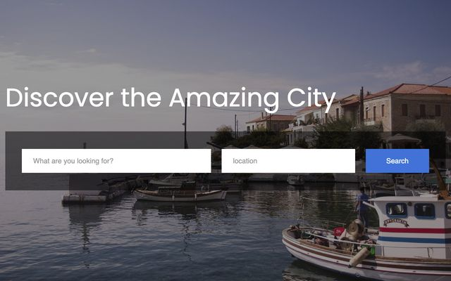</a> <b>Search Form 1</b> <a href="https://preview.colorlib.com/#colorlib-search-1">Demo</a> · <a href="colorlib-search-1/">Code</a> · <a href="https://colorlib.com/wp/template/colorlib-search-1/">Details</a></td>
<td align="center" width="33%"> <b>Search Form 2</b> <a href="https://preview.colorlib.com/#colorlib-search-2">Demo</a> · <a href="colorlib-search-2/">Code</a> · <a href="https://colorlib.com/wp/template/colorlib-search-2/">Details</a></td>
<td align="center" width="33%"><a href="https://preview.colorlib.com/#colorlib-search-3">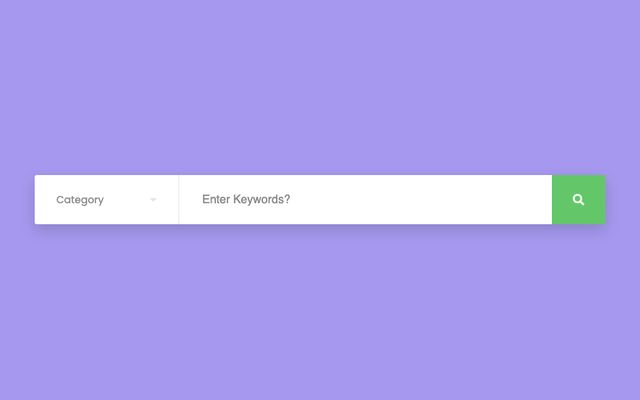</a> <b>Search Form 3</b> <a href="https://preview.colorlib.com/#colorlib-search-3">Demo</a> · <a href="colorlib-search-3/">Code</a> · <a href="https://colorlib.com/wp/template/colorlib-search-3/">Details</a></td>
</tr>
<tr>
<td align="center" width="33%"><a href="https://preview.colorlib.com/#colorlib-search-4">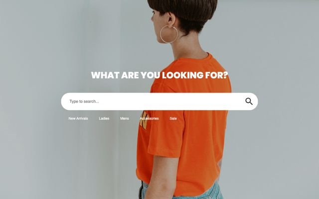</a> <b>Search Form 4</b> <a href="https://preview.colorlib.com/#colorlib-search-4">Demo</a> · <a href="colorlib-search-4/">Code</a> · <a href="https://colorlib.com/wp/template/colorlib-search-4/">Details</a></td>
<td align="center" width="33%"><a href="https://preview.colorlib.com/#colorlib-search-5">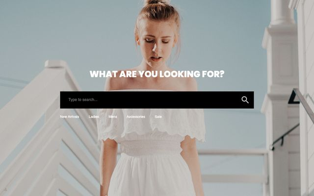</a> <b>Search Form 5</b> <a href="https://preview.colorlib.com/#colorlib-search-5">Demo</a> · <a href="colorlib-search-5/">Code</a> · <a href="https://colorlib.com/wp/template/colorlib-search-5/">Details</a></td>
<td align="center" width="33%"><a href="https://preview.colorlib.com/#colorlib-search-6">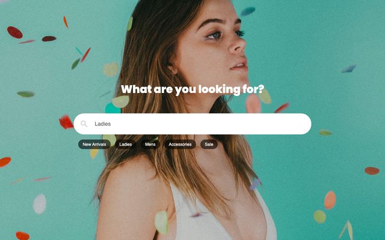</a> <b>Search Form 6</b> <a href="https://preview.colorlib.com/#colorlib-search-6">Demo</a> · <a href="colorlib-search-6/">Code</a> · <a href="https://colorlib.com/wp/template/colorlib-search-6/">Details</a></td>
</tr>
<tr>
<td align="center" width="33%"><a href="https://preview.colorlib.com/#colorlib-search-7">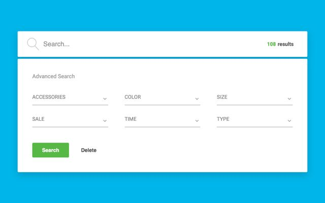</a> <b>Search Form 7</b> <a href="https://preview.colorlib.com/#colorlib-search-7">Demo</a> · <a href="colorlib-search-7/">Code</a> · <a href="https://colorlib.com/wp/template/colorlib-search-7/">Details</a></td>
<td align="center" width="33%"><a href="https://preview.colorlib.com/#colorlib-search-8">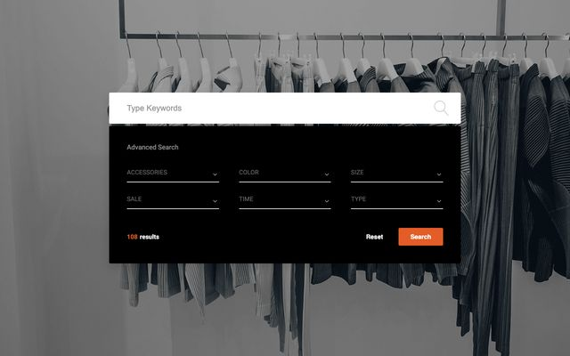</a> <b>Search Form 8</b> <a href="https://preview.colorlib.com/#colorlib-search-8">Demo</a> · <a href="colorlib-search-8/">Code</a> · <a href="https://colorlib.com/wp/template/colorlib-search-8/">Details</a></td>
<td align="center" width="33%"><a href="https://preview.colorlib.com/#colorlib-search-9">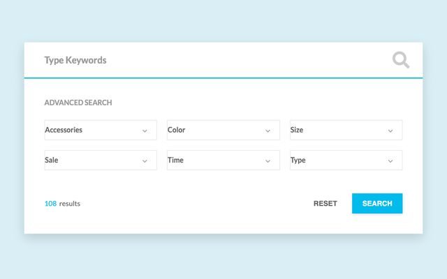</a> <b>Search Form 9</b> <a href="https://preview.colorlib.com/#colorlib-search-9">Demo</a> · <a href="colorlib-search-9/">Code</a> · <a href="https://colorlib.com/wp/template/colorlib-search-9/">Details</a></td>
</tr>
<tr>
<td align="center" width="33%"><a href="https://preview.colorlib.com/#colorlib-search-10">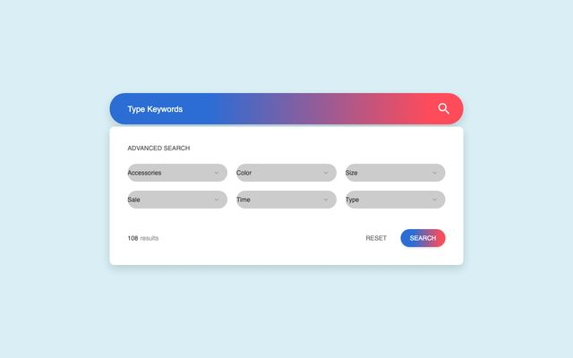</a> <b>Search Form 10</b> <a href="https://preview.colorlib.com/#colorlib-search-10">Demo</a> · <a href="colorlib-search-10/">Code</a> · <a href="https://colorlib.com/wp/template/colorlib-search-10/">Details</a></td>
<td align="center" width="33%"><a href="https://preview.colorlib.com/#colorlib-search-11">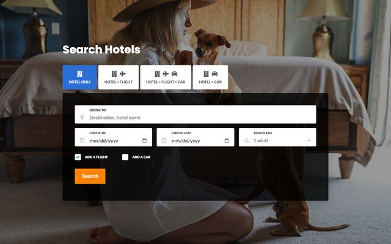</a> <b>Search Form 11</b> <a href="https://preview.colorlib.com/#colorlib-search-11">Demo</a> · <a href="colorlib-search-11/">Code</a> · <a href="https://colorlib.com/wp/template/colorlib-search-11/">Details</a></td>
<td align="center" width="33%"><a href="https://preview.colorlib.com/#colorlib-search-12">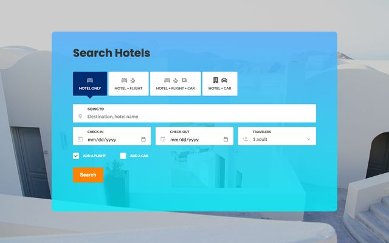</a> <b>Search Form 12</b> <a href="https://preview.colorlib.com/#colorlib-search-12">Demo</a> · <a href="colorlib-search-12/">Code</a> · <a href="https://colorlib.com/wp/template/colorlib-search-12/">Details</a></td>
</tr>
<tr>
<td align="center" width="33%"><a href="https://preview.colorlib.com/#colorlib-search-13">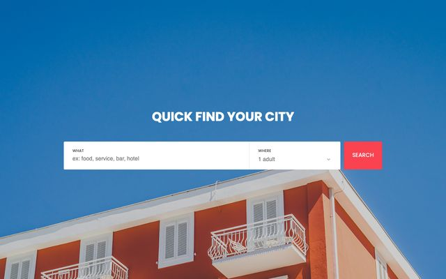</a> <b>Search Form 13</b> <a href="https://preview.colorlib.com/#colorlib-search-13">Demo</a> · <a href="colorlib-search-13/">Code</a> · <a href="https://colorlib.com/wp/template/colorlib-search-13/">Details</a></td>
<td align="center" width="33%"><a href="https://preview.colorlib.com/#colorlib-search-14">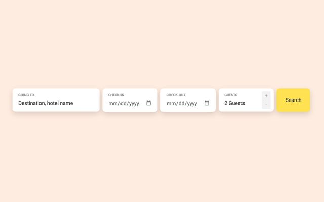</a> <b>Search Form 14</b> <a href="https://preview.colorlib.com/#colorlib-search-14">Demo</a> · <a href="colorlib-search-14/">Code</a> · <a href="https://colorlib.com/wp/template/colorlib-search-14/">Details</a></td>
<td align="center" width="33%"><a href="https://preview.colorlib.com/#colorlib-search-15">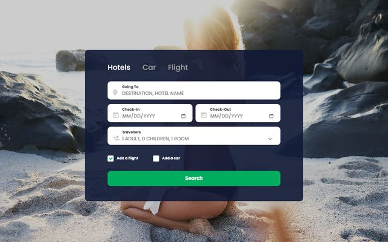</a> <b>Search Form 15</b> <a href="https://preview.colorlib.com/#colorlib-search-15">Demo</a> · <a href="colorlib-search-15/">Code</a> · <a href="https://colorlib.com/wp/template/colorlib-search-15/">Details</a></td>
</tr>
<tr>
<td align="center" width="33%"><a href="https://preview.colorlib.com/#colorlib-search-16">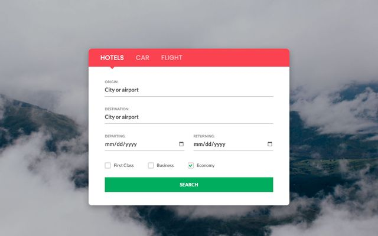</a> <b>Search Form 16</b> <a href="https://preview.colorlib.com/#colorlib-search-16">Demo</a> · <a href="colorlib-search-16/">Code</a> · <a href="https://colorlib.com/wp/template/colorlib-search-16/">Details</a></td>
<td align="center" width="33%"><a href="https://preview.colorlib.com/#colorlib-search-17">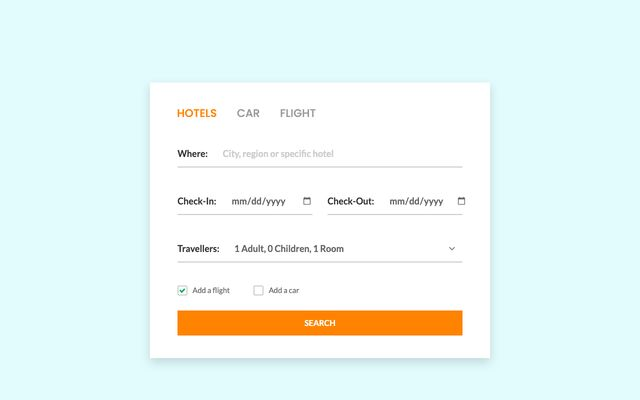</a> <b>Search Form 17</b> <a href="https://preview.colorlib.com/#colorlib-search-17">Demo</a> · <a href="colorlib-search-17/">Code</a> · <a href="https://colorlib.com/wp/template/colorlib-search-17/">Details</a></td>
<td align="center" width="33%"><a href="https://preview.colorlib.com/#colorlib-search-18">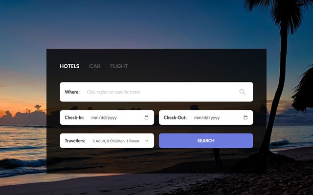</a> <b>Search Form 18</b> <a href="https://preview.colorlib.com/#colorlib-search-18">Demo</a> · <a href="colorlib-search-18/">Code</a> · <a href="https://colorlib.com/wp/template/colorlib-search-18/">Details</a></td>
</tr>
<tr>
<td align="center" width="33%"><a href="https://preview.colorlib.com/#colorlib-search-19">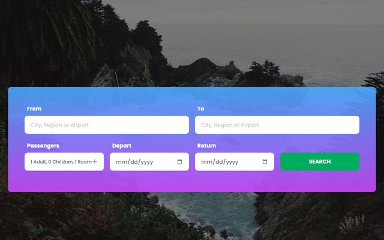</a> <b>Search Form 19</b> <a href="https://preview.colorlib.com/#colorlib-search-19">Demo</a> · <a href="colorlib-search-19/">Code</a> · <a href="https://colorlib.com/wp/template/colorlib-search-19/">Details</a></td>
<td align="center" width="33%"><a href="https://preview.colorlib.com/#colorlib-search-20">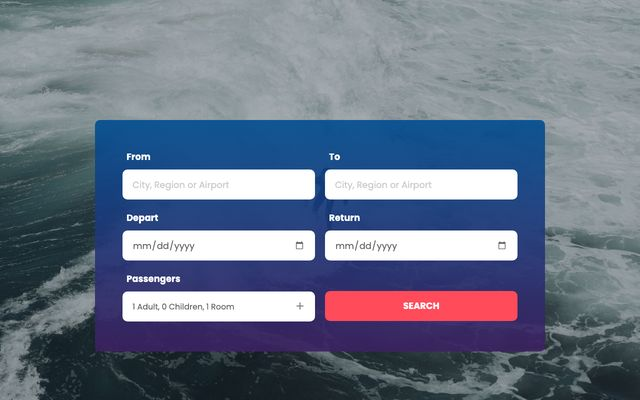</a> <b>Search Form 20</b> <a href="https://preview.colorlib.com/#colorlib-search-20">Demo</a> · <a href="colorlib-search-20/">Code</a> · <a href="https://colorlib.com/wp/template/colorlib-search-20/">Details</a></td>
<td align="center" width="33%"><a href="https://preview.colorlib.com/#colorlib-search-21">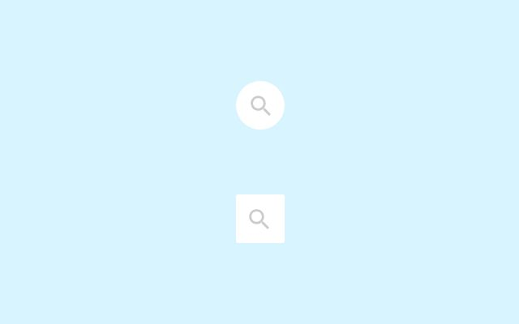</a> <b>Search Form 21</b> <a href="https://preview.colorlib.com/#colorlib-search-21">Demo</a> · <a href="colorlib-search-21/">Code</a> · <a href="https://colorlib.com/wp/template/colorlib-search-21/">Details</a></td>
</tr>
<tr>
<td align="center" width="33%"><a href="https://preview.colorlib.com/#colorlib-search-22">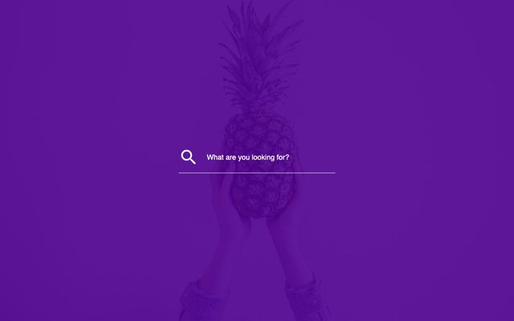</a> <b>Search Form 22</b> <a href="https://preview.colorlib.com/#colorlib-search-22">Demo</a> · <a href="colorlib-search-22/">Code</a> · <a href="https://colorlib.com/wp/template/colorlib-search-22/">Details</a></td>
<td align="center" width="33%"><a href="https://preview.colorlib.com/#colorlib-search-23">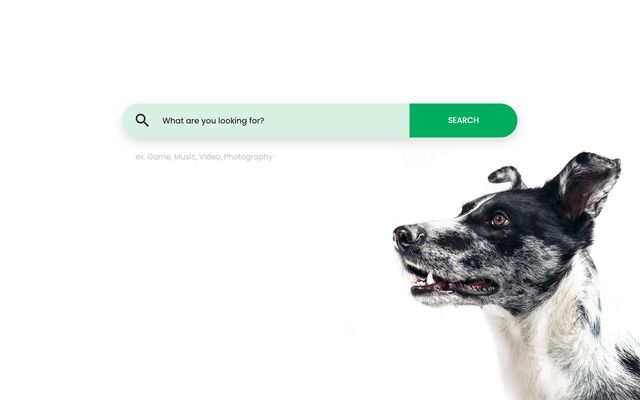</a> <b>Search Form 23</b> <a href="https://preview.colorlib.com/#colorlib-search-23">Demo</a> · <a href="colorlib-search-23/">Code</a> · <a href="https://colorlib.com/wp/template/colorlib-search-23/">Details</a></td>
<td align="center" width="33%"><a href="https://preview.colorlib.com/#colorlib-search-24">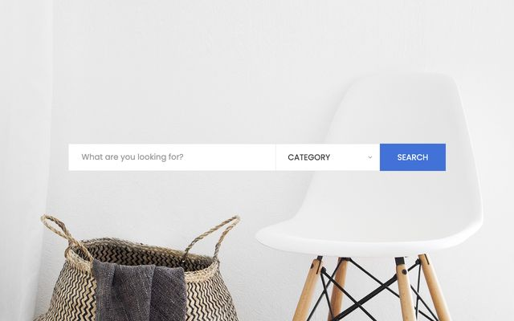</a> <b>Search Form 24</b> <a href="https://preview.colorlib.com/#colorlib-search-24">Demo</a> · <a href="colorlib-search-24/">Code</a> · <a href="https://colorlib.com/wp/template/colorlib-search-24/">Details</a></td>
</tr>
<tr>
<td align="center" width="33%"><a href="https://preview.colorlib.com/#colorlib-search-25">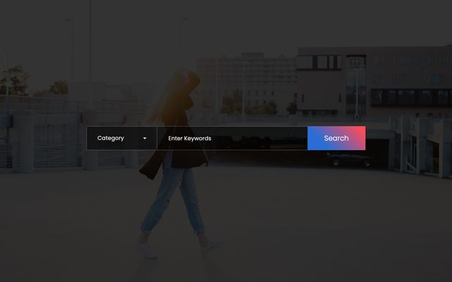</a> <b>Search Form 25</b> <a href="https://preview.colorlib.com/#colorlib-search-25">Demo</a> · <a href="colorlib-search-25/">Code</a> · <a href="https://colorlib.com/wp/template/colorlib-search-25/">Details</a></td>
</tr>
</table>

## Search bars

<table>
<tr>
<td align="center" width="33%"><a href="https://preview.colorlib.com/#search-form-bar-01">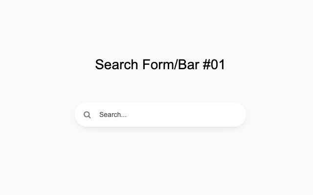</a> <b>Search Bar 01</b> <a href="https://preview.colorlib.com/#search-form-bar-01">Demo</a> · <a href="search-form-bar-01/">Code</a> · <a href="https://colorlib.com/wp/template/search-form-bar-01/">Details</a></td>
<td align="center" width="33%"><a href="https://preview.colorlib.com/#search-form-bar-02">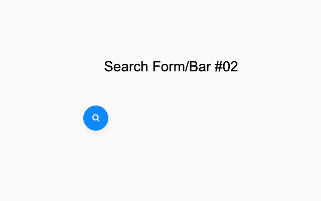</a> <b>Search Bar 02</b> <a href="https://preview.colorlib.com/#search-form-bar-02">Demo</a> · <a href="search-form-bar-02/">Code</a> · <a href="https://colorlib.com/wp/template/search-form-bar-02/">Details</a></td>
<td align="center" width="33%"><a href="https://preview.colorlib.com/#search-form-bar-03">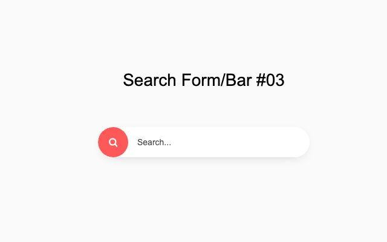</a> <b>Search Bar 03</b> <a href="https://preview.colorlib.com/#search-form-bar-03">Demo</a> · <a href="search-form-bar-03/">Code</a> · <a href="https://colorlib.com/wp/template/search-form-bar-03/">Details</a></td>
</tr>
<tr>
<td align="center" width="33%"><a href="https://preview.colorlib.com/#search-form-bar-04">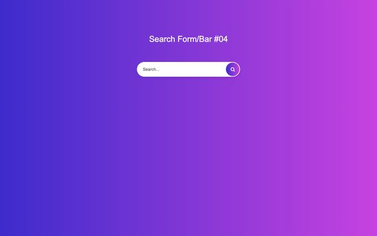</a> <b>Search Bar 04</b> <a href="https://preview.colorlib.com/#search-form-bar-04">Demo</a> · <a href="search-form-bar-04/">Code</a> · <a href="https://colorlib.com/wp/template/search-form-bar-04/">Details</a></td>
<td align="center" width="33%"><a href="https://preview.colorlib.com/#search-form-bar-05">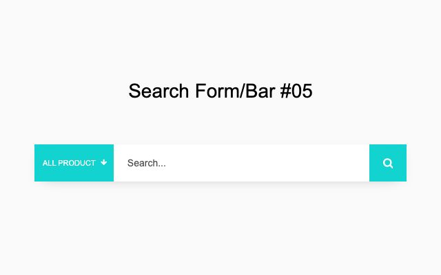</a> <b>Search Bar 05</b> <a href="https://preview.colorlib.com/#search-form-bar-05">Demo</a> · <a href="search-form-bar-05/">Code</a> · <a href="https://colorlib.com/wp/template/search-form-bar-05/">Details</a></td>
<td align="center" width="33%"><a href="https://preview.colorlib.com/#search-form-bar-06">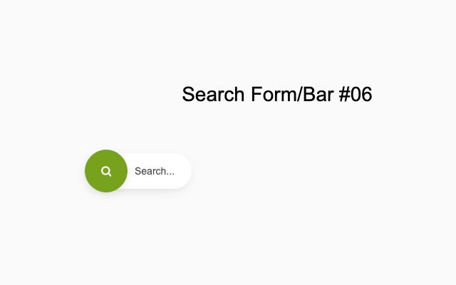</a> <b>Search Bar 06</b> <a href="https://preview.colorlib.com/#search-form-bar-06">Demo</a> · <a href="search-form-bar-06/">Code</a> · <a href="https://colorlib.com/wp/template/search-form-bar-06/">Details</a></td>
</tr>
<tr>
<td align="center" width="33%"><a href="https://preview.colorlib.com/#search-form-bar-07">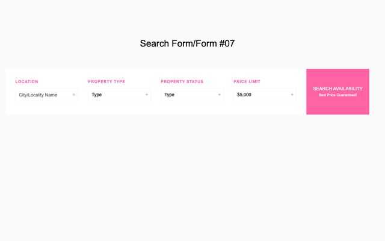</a> <b>Search Bar 07</b> <a href="https://preview.colorlib.com/#search-form-bar-07">Demo</a> · <a href="search-form-bar-07/">Code</a> · <a href="https://colorlib.com/wp/template/search-form-bar-07/">Details</a></td>
<td align="center" width="33%"><a href="https://preview.colorlib.com/#search-form-bar-08">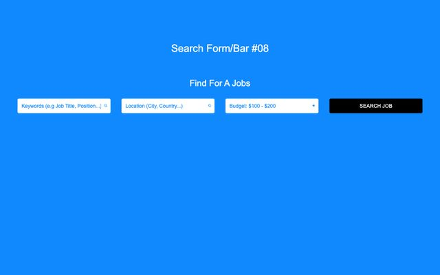</a> <b>Search Bar 08</b> <a href="https://preview.colorlib.com/#search-form-bar-08">Demo</a> · <a href="search-form-bar-08/">Code</a> · <a href="https://colorlib.com/wp/template/search-form-bar-08/">Details</a></td>
<td align="center" width="33%"><a href="https://preview.colorlib.com/#search-form-bar-09">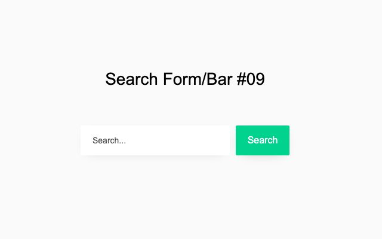</a> <b>Search Bar 09</b> <a href="https://preview.colorlib.com/#search-form-bar-09">Demo</a> · <a href="search-form-bar-09/">Code</a> · <a href="https://colorlib.com/wp/template/search-form-bar-09/">Details</a></td>
</tr>
<tr>
<td align="center" width="33%"><a href="https://preview.colorlib.com/#search-form-bar-10">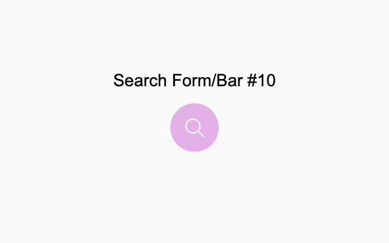</a> <b>Search Bar 10</b> <a href="https://preview.colorlib.com/#search-form-bar-10">Demo</a> · <a href="search-form-bar-10/">Code</a> · <a href="https://colorlib.com/wp/template/search-form-bar-10/">Details</a></td>
<td align="center" width="33%"> <b>Search Bar 11</b> <a href="https://preview.colorlib.com/#search-form-bar-11">Demo</a> · <a href="search-form-bar-11/">Code</a> · <a href="https://colorlib.com/wp/template/search-form-bar-11/">Details</a></td>
<td align="center" width="33%"><a href="https://preview.colorlib.com/#search-form-bar-12">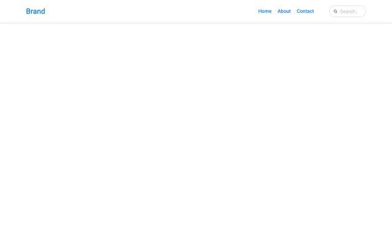</a> <b>Search Bar 12</b> <a href="https://preview.colorlib.com/#search-form-bar-12">Demo</a> · <a href="search-form-bar-12/">Code</a> · <a href="https://colorlib.com/wp/template/search-form-bar-12/">Details</a></td>
</tr>
<tr>
<td align="center" width="33%"><a href="https://preview.colorlib.com/#search-form-bar-13">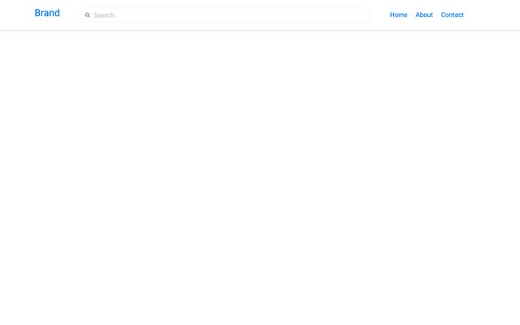</a> <b>Search Bar 13</b> <a href="https://preview.colorlib.com/#search-form-bar-13">Demo</a> · <a href="search-form-bar-13/">Code</a> · <a href="https://colorlib.com/wp/template/search-form-bar-13/">Details</a></td>
<td align="center" width="33%"> <b>Search Bar 14</b> <a href="https://preview.colorlib.com/#search-form-bar-14">Demo</a> · <a href="search-form-bar-14/">Code</a> · <a href="https://colorlib.com/wp/template/search-form-bar-14/">Details</a></td>
<td align="center" width="33%"> <b>Search Bar 15</b> <a href="https://preview.colorlib.com/#search-form-bar-15">Demo</a> · <a href="search-form-bar-15/">Code</a> · <a href="https://colorlib.com/wp/template/search-form-bar-15/">Details</a></td>
</tr>
<tr>
<td align="center" width="33%"> <b>Search Bar 16</b> <a href="https://preview.colorlib.com/#search-form-bar-16">Demo</a> · <a href="search-form-bar-16/">Code</a> · <a href="https://colorlib.com/wp/template/search-form-bar-16/">Details</a></td>
<td align="center" width="33%"> <b>Search Bar 17</b> <a href="https://preview.colorlib.com/#search-form-bar-17">Demo</a> · <a href="search-form-bar-17/">Code</a> · <a href="https://colorlib.com/wp/template/search-form-bar-17/">Details</a></td>
<td align="center" width="33%"><a href="https://preview.colorlib.com/#search-form-bar-18">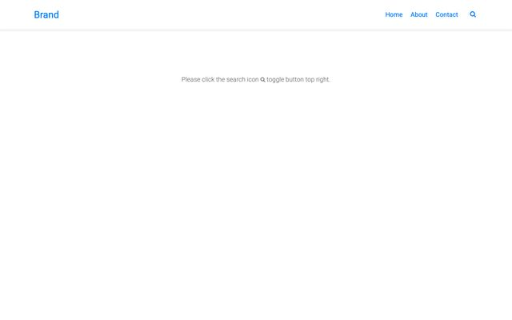</a> <b>Search Bar 18</b> <a href="https://preview.colorlib.com/#search-form-bar-18">Demo</a> · <a href="search-form-bar-18/">Code</a> · <a href="https://colorlib.com/wp/template/search-form-bar-18/">Details</a></td>
</tr>
<tr>
<td align="center" width="33%"><a href="https://preview.colorlib.com/#search-form-bar-19">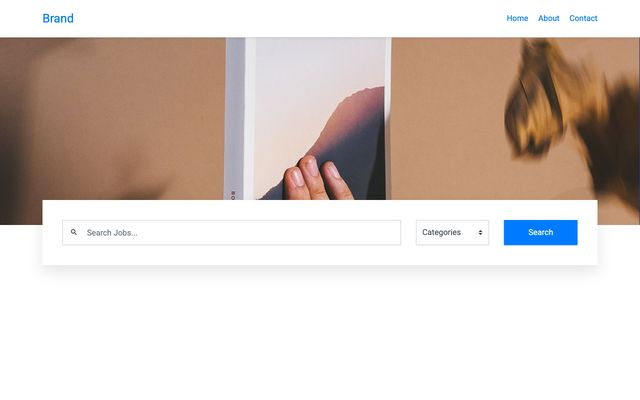</a> <b>Search Bar 19</b> <a href="https://preview.colorlib.com/#search-form-bar-19">Demo</a> · <a href="search-form-bar-19/">Code</a> · <a href="https://colorlib.com/wp/template/search-form-bar-19/">Details</a></td>
<td align="center" width="33%"> <b>Search Bar 20</b> <a href="https://preview.colorlib.com/#search-form-bar-20">Demo</a> · <a href="search-form-bar-20/">Code</a> · <a href="https://colorlib.com/wp/template/search-form-bar-20/">Details</a></td>
</tr>
</table>

## How to use one

1. Clone the repo, or download it as a ZIP from the green **Code** button.
2. Copy the folder of the template you want into your project.
3. Open its `index.html` in a browser. Every folder is self-contained: `css/style.css`, a small `js/snippet.js` where the template needs behaviour, plus its own fonts and images.

Using Bootstrap already? Load the template's `css/style.css` after your framework stylesheet. Class names are namespaced per template, so they won't collide with yours.

## License

Free for personal and commercial use, including client work. Attribution is appreciated but not required. Photography, where present, is licensed for use inside these templates. See [LICENSE.md](LICENSE.md).

## More free templates from Colorlib

- [Free HTML & CSS Login Form Templates](https://github.com/ColorlibHQ/login-form-templates)
- [Free HTML & CSS Registration Form Templates](https://github.com/ColorlibHQ/registration-form-templates)
- [Free Coming Soon & Under Construction Page Templates](https://github.com/ColorlibHQ/coming-soon-page-templates)
- [Free HTML & CSS Contact Form Templates](https://github.com/ColorlibHQ/contact-form-templates)
- [Free 404 & Error Page Templates](https://github.com/ColorlibHQ/404-error-page-templates)
- [Free Multi-Step Form & Form Wizard Templates](https://github.com/ColorlibHQ/multi-step-form-templates)
- [Free Booking & Appointment Form Templates](https://github.com/ColorlibHQ/booking-form-templates)
- [Free Navigation Menu, Sidebar & Dropdown Templates](https://github.com/ColorlibHQ/navigation-menu-templates)
- [Free HTML & CSS Table Templates](https://github.com/ColorlibHQ/html-table-templates)
- [Free HTML Form Templates: Job Application, Survey & Newsletter](https://github.com/ColorlibHQ/html-form-templates)
- [Free HTML & CSS UI Components](https://github.com/ColorlibHQ/html-css-ui-components)

Building an admin panel or a web app?

- [Gentelella](https://github.com/ColorlibHQ/gentelella) and [Adminator](https://github.com/puikinsh/Adminator-admin-dashboard): free admin dashboard templates
- [DashboardPack](https://dashboardpack.com/templates/?utm_source=github&utm_medium=readme&utm_campaign=search-form-templates): premium dashboards for React, Vue, Angular, Next.js, Laravel and plain HTML

Made by [Colorlib](https://colorlib.com/).
